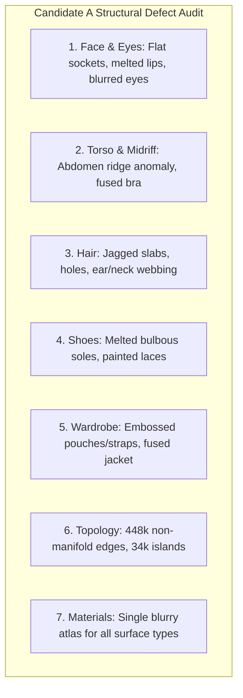

# NYRA — Candidate A Strict Quality Audit & Structural Reconstruction Plan

> [!IMPORTANT]
> **Active Base Lock:** Candidate A (`recovery/nyra/candidates/candidate-a/nyra-a.glb`) is locked as the **sole authorized working foundation**. All alternative candidate generation, Candidate C creation, and Pixal3D reruns are strictly barred. All historical checkpoints remain intact.
> 
> **Scope Enforcement:** This document executes **Phase 1 Only** (Strict Audit & Actionable Blueprint). No rigging, animation, or game integration will be attempted until Candidate A passes the visual gate following Phase 2 reconstruction.

---

## 1. Executive Summary & Raw Mesh Diagnosis

Candidate A was generated via multi-view neural reconstruction (Trellis / Pixal3D multi-view flow from two orthographic inputs). While it establishes the broad spatial proportions, adult feminine stance, and color blocking of the approved NYRA design, **in its raw generated state it completely fails the required quality bar for a premium hero character**.

```
Candidate A Raw Mesh Metrics:
├── Total Vertices:          724,640
├── Total Triangles:         958,378
├── Mesh Hierarchy:          1 Monolithic Object ("Mesh_0")
├── Connected Face Islands:  34,578 (severe internal fragmentation)
├── Non-Manifold Edges:      448,590 (46.8% edge topological defect rate)
├── Material Slots:          1 ("Material_0")
├── Texture Resolution:      4096 × 4096 (1 Base Color, 1 Metallic/Roughness)
└── Rigging / Skinning:      None (unweighted, raw surface)
```

The model is **not a coherent surface mesh**; it is an unstitched voxel isosurface exhibiting massive internal cavities, floating triangle debris, non-manifold edge tethers, and fused anatomical boundaries.

---

## 2. Reference Comparison Matrix

| Visual Element | Authoritative Target (Ref Images 1–5) | Raw Candidate A Current State | Defect Severity |
| :--- | :--- | :--- | :--- |
| **Face & Eyes** | Defined almond eyes, moist cornea, sculpted lips, delicate nose, feminine jawline (Image 5) | Sunken, flat eye textures painted over undifferentiated skull lumps; melted, swollen lip geometry; blobby nose bridge | **CRITICAL** |
| **Torso & Midriff** | Athletic, toned abdominal wall with defined navel; distinct crop-top sports bra (Image 1, 2) | Sharp anomalous horizontal ridge protruding from midriff; bra and skin fused into continuous noisy surface | **CRITICAL** |
| **Hair & Ponytail** | High-volume flowing ponytail, separate bangs, dynamic violet strand accent (Image 1, 3) | Heavy, jagged, non-manifold polygon slabs with gaping tears; webbed strands fusing hair into neck and ears | **HIGH** |
| **Footwear** | Chunky ergonomic high-top sneakers, layered soles, sharp lace and tongue geometry (Image 1, 2, 4) | Bulbous, melted soles merging into ground plane; smeared low-res texture projection on flat toe caps | **HIGH** |
| **Wardrobe & Props** | Dropped purple jacket with physical thickness, utility belt with modular pouches, gloves (Image 1–4) | Jacket fused into upper torso; pouches and belt straps embossed directly onto thighs as shallow surface noise | **MEDIUM-HIGH** |

---

## 3. Top 5 Most Visible Quality Problems

### Problem 1: Facial Anatomy Collapse & Identity Drift
* **Observation:** The face lacks proper 3D anatomical planes. The orbits are shallow, textured depressions rather than sockets; the eyes are flat decals projected onto bumpy geometry without spherical eyeballs or crisp eyelid rims. The lips are fused and asymmetrical with melted commissures. The nasal cartilage is undefined.
* **Impact:** Renders appear uncanny, lifeless, and cartoonish, completely missing the mature, attractive, semi-realistic portrait in Reference Image 5.

### Problem 2: Anomalous Abdominal Ridge & Midriff Deformation
* **Observation:** A prominent horizontal ridge of extruded triangles slices across the exposed abdomen. In clay shading, this appears as an unnatural fleshy fold or torn seam directly below the crop-top band.
* **Impact:** Destroys the athletic, toned female silhouette shown in the concept art, creating an immediate visual blemish in any frontal or 3/4 camera view.

### Problem 3: Solidified, Torn Hair Slabs with Non-Manifold Tears
* **Observation:** The hair is reconstructed as thick, jagged polygon chunks with 34,000+ loose island artifacts, hollow gaps, and skin-webbing around the ears and neck.
* **Impact:** The hairstyle looks like broken brittle stone or melted plastic rather than organic hair. It is completely unriggable and cannot support secondary motion or physics.

### Problem 4: Melted Sneaker Outsoles & Amorphous Footwear
* **Observation:** The sneakers lack functional architectural structure. The sole treads are bulbous, asymmetric lumps that sag unevenly into the ground plane. Laces and eyelets are smeared 2D texture lines painted over lumpy toe boxes, with no tongue separation.
* **Impact:** Compromises the grounded athletic aesthetic of a high-speed metro runner, appearing cheap and unfinished from all angles.

### Problem 5: Monolithic Wardrobe Fusion & Embossed Hardware
* **Observation:** The dropped jacket, sports bra, utility belt, holsters, straps, and leggings are welded into a single continuous geometric crust. Buckles, pouches, and belt loops exist solely as shallow surface bumps rather than discrete props.
* **Impact:** Prevents proper material definition (everything shares a single low-roughness PBR map) and creates severe geometric distortion when rigged.

---

## 4. Feasibility Boundary: What is Fixable in Blender vs. Unfixable

### Realistically Fixable in Blender (Phase 2 Target Scope)
1. **Topological Healing & Remeshing:**
   * Eliminating the 448k non-manifold edges and 34k floating islands via quad-dominant retopology / Voxel Remeshing + Shrinkwrap workflows.
2. **Facial Reconstruction & Sculpting:**
   * Carving proper eye sockets, inserting separate eyeball spheres, sculpting crisp eyelid margins, refining the philtrum and lip volume, and sharpening the jawline and nasal bridge using Dyntopo/Multiresolution sculpting in Blender.
3. **Midriff & Torso Planing:**
   * Digitally excising the anomalous abdominal ridge, smoothing the midriff wall, and carving athletic abdominal muscle definition matching Reference Image 2.
4. **Garment Decoupling & Shell Extraction:**
   * Separating the dropped jacket from the torso into an independent mesh shell with physical thickness (Solidify modifier), collar lapels, and cuffed sleeve hems.
5. **Discrete Hard-Surface Props:**
   * Modeling clean geometric base meshes for the belt, hip pouches, buckles, and straps, replacing the melted embossed bumps.
6. **Sneaker Rebuilding:**
   * Sculpting and blocking out clean sole tiers, distinct upper paneling, and dimensional laces.
7. **Modular Shader Splitting:**
   * Splitting `Material_0` into 5 dedicated PBR shaders (Skin/Face, Leather/Jacket, Technical Fabric/Leggings, Hair, and Metals/Eyes).

### NOT Realistically Fixable Without Regeneration / External Redraw
1. **Baking Microscopic Pores & Wrinkles from Existing Texture:**
   * The single 4096 atlas lacks high-frequency pore data; microscopic skin micro-normals cannot be extracted from the blurry neural texture and must be provided via procedural detail or clean hand-painted normal maps.
2. **Automated Hair Grooming from Voxel Slabs:**
   * The existing hair mesh cannot be "unmelted" into individual strands; it must be replaced or heavily re-topped with stylized hair volume clusters.
3. **Internal Underside Data of Fused Clothing:**
   * Geometry hidden behind the dropped jacket or underneath the belt does not exist in the neural raw output and must be manually built or hollowed out.

---

## 5. Comprehensive 7-Area Defect Audit



### 1. Face / Facial Structure / Attractiveness
* **Geometry:** The orbital rim is shallow; there is no eyeball sphere geometry (eyes are painted onto flat concave sockets). Nasal bone and alar cartilages lack separation. Upper and lower vermilion borders of the lips are indistinct and partially bridged by polygon slivers.
* **Texture/Shading:** Pupil and iris textures are blurry and misaligned; eyelashes are smeared black streaks.
* **Actionable Correction:** Carve deep eye sockets, insert UV-sphere eyeballs with dedicated corneal shaders, sculpt lips with distinct philtrum and oral fissure, and refine feminine cheekbones to match Reference Image 5.

### 2. Torso / Chest / Upper-Body Silhouette
* **Geometry:** The horizontal midriff ridge (approx. Z = 0.98m to 1.05m world height) forms a sharp triangular shelf protruding outward by ~12mm. The breast volume is asymmetric and flattens abruptly at the lateral rib margins.
* **Texture/Shading:** Skin color bleeds into the lower sports bra hem with fuzzy projection fringes.
* **Actionable Correction:** Slice away the protruding ridge, blend the abdominal wall with smooth athletic muscle contouring, and restore the navel depression.

### 3. Hair Shape, Volume, and Material Quality
* **Geometry:** The high ponytail consists of jagged polygonal sheets with jagged edges, internal self-intersections, and void cavities. Face-framing tendrils are bridged to the cheeks and neck by thin triangle webbing.
* **Texture/Shading:** The purple accent streak is a muddy gradient with blurry fringes rather than a crisp dye-streak.
* **Actionable Correction:** Sever hair-skin bridges, sculpt cohesive stylized hair clumps following the ponytail curve in Reference Image 3, and establish clean alpha-tested hair card geometry for bangs.

### 4. Shoes / Feet / Lower-Leg Quality
* **Geometry:** Foot silhouettes lack ergonomic sneaker contours. Outsoles are blobby and ground-fused; heel counters and toe springs are uneven between left and right feet.
* **Texture/Shading:** Sole treads and purple midsole wedges are smeared into each other.
* **Actionable Correction:** Retopologize the footwear into structured sole, midsole, and upper assemblies, giving crisp edges to the chunky athletic sole shown in Reference Image 4.

### 5. Outfit Cleanup and Silhouette Readability
* **Geometry:** Utility pouches on the right and left hips are fused directly into the pelvic mesh. Belt straps spanning the hips have no thickness or offset.
* **Texture/Shading:** Legging chevron striping has jagged pixel artifacts along the diagonal boundaries.
* **Actionable Correction:** Decouple pouches as independent sub-objects, model clean strap geometry, and align purple chevron accents with clean edge loops.

### 6. Major Mesh Clipping, Deformations, & Topological Chaos
* **Data:** 34,578 separate components and 448,590 non-manifold edges.
* **Actionable Correction:** Run automated topological pruning (delete loose parts < 100 faces), perform a unified Voxel Remesh at 1.5mm voxel size to create a 100% watertight, manifold base volume, followed by quad-retopology.

### 7. Material Quality & Shading Consistency
* **Data:** All surfaces are bound to a single diffuse map and single roughness map with no subsurface scattering, clearcoat, or anisotropy.
* **Actionable Correction:** Re-assign materials into distinct shading domains:
  1. `M_Skin`: Principled BSDF with Subsurface Scattering (0.05 scale, reddish radius).
  2. `M_Jacket`: Semi-gloss synthetic fabric / leatherette with custom normal maps.
  3. `M_Leggings`: Matte elastane/nylon with micro-weave roughness.
  4. `M_Hair`: Anisotropic roughness with distinct purple strand mask.
  5. `M_Hardware`: High metallic (1.0), low roughness (0.2) for buckles and zippers.

---

## 6. Targeted Reconstruction Blueprint for GPT-6 Sol High (Phase 2 Plan)


### Stage 1: Topology Cleanup & Base Remesh
1. Load `recovery/nyra/candidates/candidate-a/renders/original/nyra-review.blend`.
2. Delete isolated floating geometry and interior non-manifold debris:
   * Select `Mesh_0` -> Edit Mode -> Select Loose Geometry -> Delete.
   * Run Mesh -> Clean up -> Degenerate Dissolve and Delete Loose.
3. Generate a clean, unified watertight sculpting proxy via Voxel Remesh (voxel size: `0.0025m` / 2.5mm).

### Stage 2: Facial & Head Reconstruction (Matching Reference Image 5)
1. In Sculpt Mode, block out feminine facial planes using Clay Strips and Smooth brushes.
2. Carve anatomical orbital sockets; place two distinct UV spheres for the left and right eyeballs.
3. Sculpt crisp upper and lower eyelids conforming over the spheres.
4. Refine nasal tip, alar base, and bridge; sculpt lips with sharp cupid's bow and realistic vermilion border.
5. Sever and clean all hair geometry intersecting ears and cheeks; reconstruct clean face-framing fringe locks.

### Stage 3: Torso & Silhouette Planing (Matching Reference Images 1 & 2)
1. Using the Flatten / Scrape and Smooth brushes, completely eliminate the horizontal midriff ridge.
2. Sculpt anatomical abdominal contours (linea alba, rectus abdominis muscle tone, umbilical depression).
3. Ensure the sports bra band forms a clean raised boundary over the rib cage.

### Stage 4: Wardrobe & Hard-Surface Decoupling
1. **Dropped Jacket:** Separate the jacket region into a distinct object `NYRA_Jacket`. Apply Solidify modifier (thickness `0.004m`) to give realistic fabric depth.
2. **Belt & Pouches:** Model a clean parametric belt ring (`NYRA_Belt`) with buckle hardware and separate the hip pouches into distinct prop objects (`NYRA_Pouch_L`, `NYRA_Pouch_R`).
3. **Leggings:** Rebuild edge loops following the purple chevron panel paths for crisp texture boundaries.

### Stage 5: Sneaker & Footwear Remodeling (Matching Reference Images 1 & 4)
1. Separate sneaker geometry below the ankle cuffs (`NYRA_Footwear`).
2. Retopologize the outsole into a clean multi-tiered athletic sole with flat, stable ground contact.
3. Model distinct tongue, collar padding, and dimensional lace geometry.

### Stage 6: UV Repacking & Multi-Material Assignment
1. Unfold clean UV islands without overlapping seams for each separated sub-object.
2. Establish 5 core PBR materials in Blender with dedicated Principled BSDF setups.
3. Reproject base color and bake clean normal maps from the high-res sculpt onto the optimized topology.

---

## 7. Quality Gate Checklist (Phase 3 Criteria)

Before any consideration of Phase 4 (rigging, export, or game integration), Candidate A must strictly satisfy the following criteria:

- [ ] **Face Quality:** Close-up face render demonstrates clear feminine facial anatomy matching Reference Image 5 (no flat eyes, no melted lips).
- [ ] **Midriff Quality:** Zero trace of the horizontal abdominal ridge; smooth, toned midriff.
- [ ] **Hair Quality:** Hair silhouette is clean, voluminous, and free of jagged non-manifold holes and skin-welds.
- [ ] **Footwear Quality:** Sneakers exhibit distinct soles, laces, and grounded profile matching Reference Image 4.
- [ ] **Object Separation:** Jacket, body, hair, belt/pouches, and footwear exist as clean, decoupled sub-meshes.
- [ ] **Topology:** 100% manifold, zero disconnected island noise, polygon count optimized for performance.

**Verdict on Raw Candidate A:** **FAILS VISUAL GATE IN RAW STATE — PROCEED TO PHASE 2 RECONSTRUCTION.**
