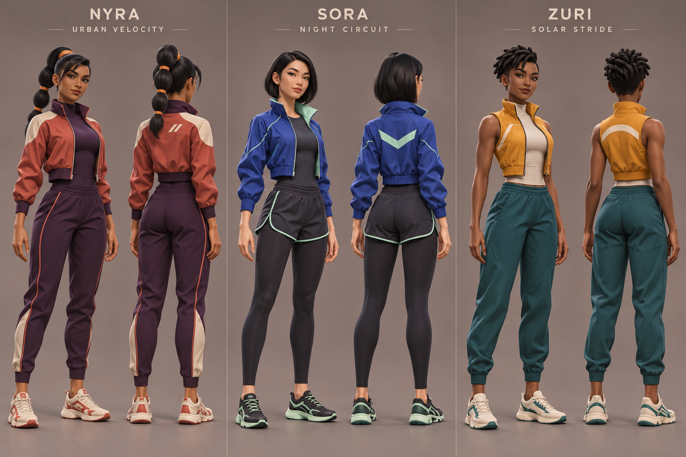

# NYRA — Urban Velocity

Standalone character project for Metro Runner 3D. **Phase 1: research, art direction and an executable asset foundation.** No changes to the `ss` game repository.



The selected direction is NYRA: an adult runner with coral/cream technical outerwear, plum trackwear and a segmented black ponytail. The image above is AI-generated concept art, **not a render of an existing NYRA mesh**.

## Delivered

- Official Rain editable `.blend` and 22 PNG textures, with SHA-256 provenance and CC BY 4.0 attribution.
- Actual front/rear Blender renders of Rain, plus a static clay geometry GLB for inspection.
- Verified Blender save, CPU render, Metal GPU render, Eevee render and GLB export.
- Three concepts, four ranked foundation approaches, licensing and production decisions.
- Independent local viewer with orbit, front/rear, wireframe, rotation, local GLB loading and animation selection for future animated assets.

## Open the work

```sh
npm ci --ignore-scripts
npm run viewer
```

Open http://127.0.0.1:8765/viewer/ . The server is loopback-only. No account or hosted service is needed. Dependencies are pinned; the viewer loads them locally.

Editable upstream source: [`source/blender/rain/rain_v3.2.blend`](source/blender/rain/rain_v3.2.blend). The official v3 URL currently downloads an archive labeled **Rain v3.3** containing this v3.2-named file. Names and bytes are preserved, not silently relabeled. Keep its adjacent `textures` folder.

## Reproduce verification

Set `BLENDER` if it is not on PATH and not installed at the macOS default location.

```sh
python3 scripts/run_environment_audit.py
"$BLENDER" --background --disable-autoexec source/blender/rain/rain_v3.2.blend --python scripts/inspect_asset.py
"$BLENDER" --background --disable-autoexec source/blender/rain/rain_v3.2.blend --python scripts/render_foundation.py
"$BLENDER" --background --disable-autoexec source/blender/rain/rain_v3.2.blend --python scripts/export_foundation_study.py
npm run validate
python3 scripts/verify_project.py
```

For macOS, first run `export BLENDER=/Applications/Blender.app/Contents/MacOS/Blender`. Rendering and export scripts never overwrite the original Rain files. Embedded upstream Python is disabled in these evaluation commands. Cold GPU probes allow 180 seconds by default; override with the `BLENDER_PROBE_TIMEOUT` environment variable.

## Status and next steps

Read [ART_DIRECTION](ART_DIRECTION.md), [ASSET_RESEARCH](ASSET_RESEARCH.md), [ASSET_LICENSES](ASSET_LICENSES.md), [PRODUCTION_PLAN](PRODUCTION_PLAN.md), [ENVIRONMENT_AUDIT](ENVIRONMENT_AUDIT.md) and [QA](qa/README.md).

**Not yet built:** the customized NYRA mesh, final clothes/hair/textures, production game skeleton, animations, LODs and mobile performance validation. The 76,974-triangle clay GLB has no rig and is a foundation study. The test cube is only environment evidence. Neither is a finished NYRA asset.

Actual execution was on the local Mac. No cloud machine was provisioned or verified.

Rain Rig (CC) Blender Foundation | [studio.blender.org](https://studio.blender.org/characters/rain/v3/) — [CC BY 4.0](https://creativecommons.org/licenses/by/4.0/). Changes to inspection derivatives are documented in ASSET_LICENSES.md.
